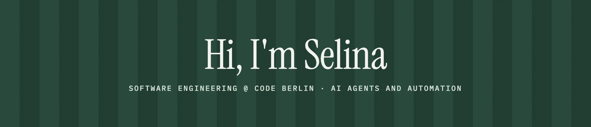
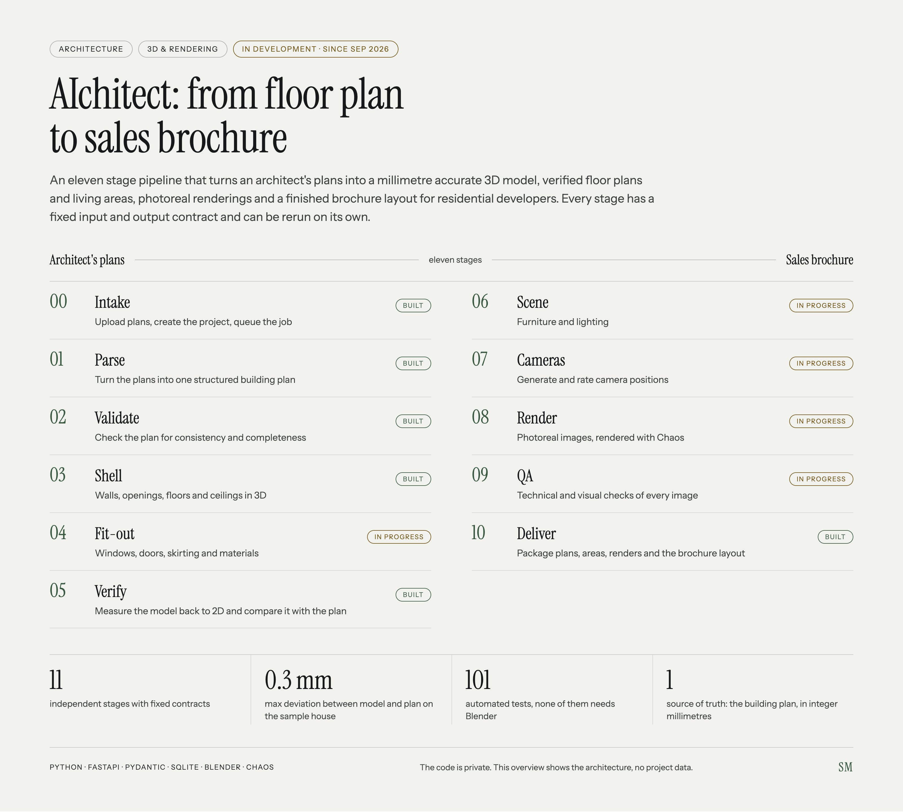
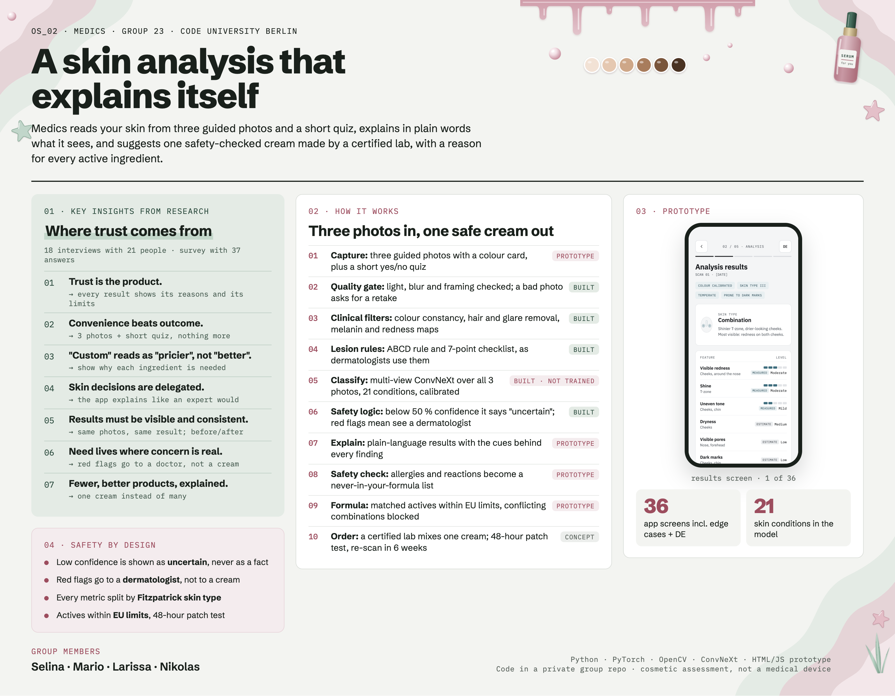
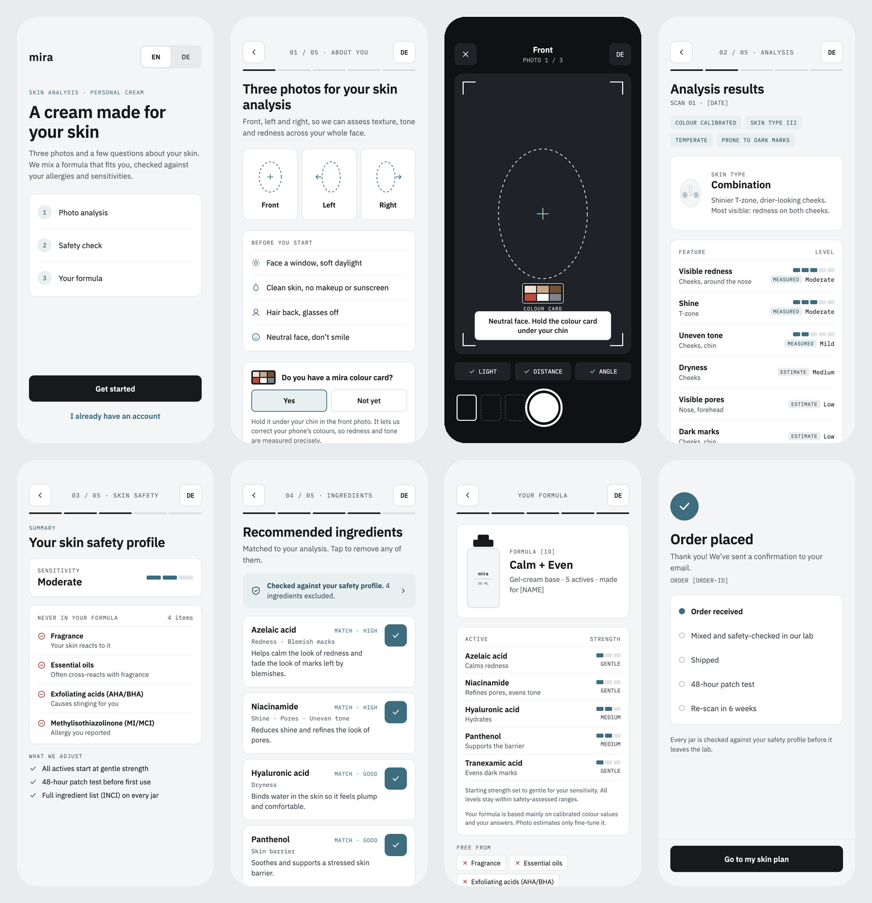

  
  
  
  

  
  
  

---

##  About me

Software Engineering student at **CODE University of Applied Sciences** in Berlin.
I build things that make complex information easier to understand, right where **code, design and psychology** meet.

-  Started coding at 15 in an advanced computer science course at school
-  Spent a year in **San Francisco**: AI & operations internship at a psychology coaching practice, au pair, and a **Stanford Continuing Studies** program in technology leadership
-  **2nd place** at the CODE Hackathon with Vibolingo
-  German · English · Chinese (HSK 3)

##  What I'm working on

<table>
  <tr>
    <td width="50%" valign="top">
      <h3> AIchitect</h3>
      A Python pipeline that turns an architect's DWG files and floor plans into a 3D model, V-Ray and Veras renders and a print-ready magazine for client presentations. It runs end to end and takes <b>about a week instead of three months</b>. I did the analysis, research, automation and the first version of the code.
        <a href="#aichitect">See the roadmap ↓</a>
    </td>
    <td width="50%" valign="top">
      <h3> Head of Marketing @ <a href="https://friseurtelefon.de">mitJulia</a></h3>
      An AI receptionist that picks up the phone for hair salons. I own content strategy, video scripts and Meta Ads on our way to <b>1M ARR</b>.
    </td>
  </tr>
  <tr>
    <td width="50%" valign="top">
      <h3> Focus display</h3>
      Built with my Software Engineering professor: a small hardware screen next to your computer that shows whether your code is still running and whether you're heads-down or free to talk.
    </td>
    <td width="50%" valign="top">
      <h3> My own AI agents on Claude</h3>
      A morning briefing from my inbox and calendar, an agent that turns emails into calendar events, a weekly bilingual newsletter and an evening Chinese vocab tutor.
    </td>
  </tr>
</table>

##  AIchitect: from floor plan to sales brochure

An 11 stage pipeline that turns an architect's plans into a millimetre accurate 3D model, verified floor plans and living areas, photoreal renderings and a finished brochure layout. Built for residential developers in Germany, Austria and Switzerland. The code is private, so here is the architecture instead.

  

- **One source of truth:** the 3D model is never edited by hand, it is always rebuilt from the building plan
- **Independent stages:** every stage has a fixed input and output contract and can be rerun on its own
- **Selective rebuild:** change a wall color and only the stages that depend on it run again
- **Verified geometry:** the model is measured back to 2D and compared with the plan, max deviation 0.3 mm on the sample house

##  Medics: a skin analysis that explains itself

Group project at CODE University (Group 23, with Mario, Larissa and Nikolas). An app that reads your skin from three guided photos and a short quiz, explains in plain words what it sees, and suggests one safety-checked cream made by a certified lab. The code lives in a private group repo, so here is the overview instead.

  

- **Research first:** 18 interviews with 21 people and a survey with 37 answers led to seven insights, for example "Trust is the product" and "Custom reads as pricier, not better"
- **Model with guardrails:** a three-photo pipeline with clinical image filters, the ABCD rule and the 7-point checklist, and a multi-view ConvNeXt. Low confidence becomes "uncertain", red flags send you to a dermatologist
- **Fair by design:** balanced sampling over skin tones, every metric split by Fitzpatrick skin type, and a biopsy-proven test set kept untouched
- **Safe formula:** allergies and reactions become a never-in-your-formula list, actives stay within EU limits and conflicting combinations are blocked

<b>The app prototype (36 screens)</b>

 

  

##  Tech stack

  

  
  
  
  

##  Featured projects

<table>
  <tr>
    <td colspan="2" valign="top">
      <h3> <a href="#medics">Medics</a></h3>
      AI skin analysis from three photos that explains what it sees and suggests one safety-checked cream. Group project at CODE University, with user research, a 36-screen app prototype and a skin analysis pipeline in Python. <a href="#medics">See the overview ↓</a>  
      
      
      
      
    </td>
  </tr>
  <tr>
    <td width="50%" valign="top">
      <h3> <a href="https://github.com/meuselina/Vibolingo">Vibolingo</a></h3>
      2nd place at the CODE Hackathon. "Duolingo for vibe coding": five minute lessons that teach people how to direct AI to build real apps.  
      
      
      
    </td>
    <td width="50%" valign="top">
      <h3> <a href="https://github.com/meuselina/My-personal-website-and-CV">Personal website</a></h3>
      Trilingual portfolio (EN / DE / ZH) with newsletter and an AI agents section.  
      
      
      
      
    </td>
  </tr>
  <tr>
    <td width="50%" valign="top">
      <h3> <a href="https://github.com/meuselina/image-simplifier">Image Simplifier</a></h3>
      Command line tool that shrinks PNG files by merging similar colors (color quantization).  
      
      
    </td>
    <td width="50%" valign="top">
      <h3> <a href="https://github.com/meuselina/Shop-coded-with-Java">Fashion shop</a></h3>
      Desktop shop app with categories, search and price sorting, built with inheritance.  
      
      
    </td>
  </tr>
  <tr>
    <td width="50%" valign="top">
      <h3> <a href="https://github.com/meuselina/binary-trees">Binary Trees</a></h3>
      Binary tree algorithms: traversals, height, search and insert.  
      
      
    </td>
    <td width="50%" valign="top">
      <h3> <a href="https://github.com/meuselina/java-calculator">Calculator</a></h3>
      Console calculator with input validation and big number support.  
      
      
    </td>
  </tr>
</table>

##  Contribution snake

  <picture>
    <source media="(prefers-color-scheme: dark)" srcset="https://raw.githubusercontent.com/meuselina/meuselina/output/github-snake-dark.svg" />
    <source media="(prefers-color-scheme: light)" srcset="https://raw.githubusercontent.com/meuselina/meuselina/output/github-snake.svg" />
    
  </picture>

##  Let's connect

I'm looking for a **summer 2027 internship** (free from May to September) in **AI engineering or full stack**, ideally at an early-stage startup where I can ship real things. If that sounds like your team, I'd love to hear from you.

  
  
  
  

